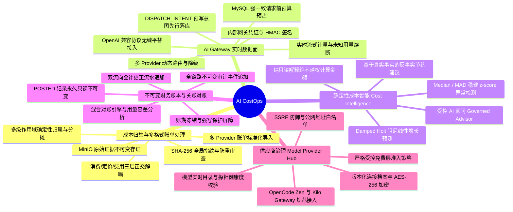
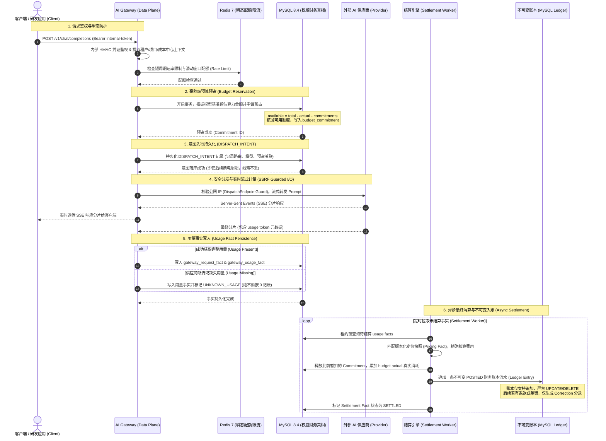

<div align="center">

# AI CostOps

### 面向企业与研发团队的一体化 AI 成本治理（FinOps for AI）与实时网关平台

<p align="center">
  <a href="https://github.com/BangShou1st/AI-CostOps/actions">
    
  </a>
  
  
  
  
  
  
  
  
  
  
  
</p>

<p align="center">
  <b>融合多源账单归集 · 实时网关计量与预算预占 · 确定性成本智能 · 不可变账本与关账审计的一体化 FinOps for AI 平台</b>
</p>

---

[核心功能](#-核心功能) • [系统架构](#-系统架构) • [核心财务不变量](#-核心财务真相与不可变边界) • [业务流程时序](#-关键业务时序) • [技术栈](#-技术栈) • [快速开始](#-快速开始) • [供应商治理](#-供应商治理-model-provider-hub) • [代码结构](#-代码库结构与规模事实) • [CI 与安全](#-ci-与持续安全) • [贡献与状态](#-项目状态与贡献)

</div>

<br />

## 📖 项目背景与业务痛点

随着生成式 AI 与大语言模型（LLM）在企业研发链路（代码辅助、自动化测试、文档问答、数据分析与自主 Agent）中的深度落地，算力支出迅速从早期的“实验性零星费用”演变为企业每月数十万乃至上百万元的战略核心支出。然而，传统云原生 FinOps 工具与朴素的网关代理面对 AI 算力消费时，暴露出了致命的财务断层：

* **1. 多厂商账单格式与计费口径严重割裂 (Format & Pricing Fragmentation)**  
  企业内部通常并发混用 OpenAI、DeepSeek、MiMo、Moonshot Kimi、智谱 GLM、OpenCode Zen、Kilo Gateway 及自建兼容网关。各 Provider 的账单结构截然不同，Token 计费维度（Input / Output / Cache Read / Cache Write）、时区与币种各异，导出周期从实时到按月跨度极大。财务人员只能手工下拉 CSV 表格机械对齐，陷入无法消除的“账单孤岛”。

* **2. 缺乏请求发生前的实时预算预占 (No Request-Time Budget Reservation)**  
  传统云成本管理纯属“事后诸葛亮”，仅在账单落地后提供滞后报表。当研发人员遭遇死循环调用、测试脚本并发失控或 Prompt 爆炸时，系统无法在 API 请求发生的毫秒级瞬间核定当前组织/团队/项目的剩余可用预算，极易导致预算击穿（Budget Overrun）惨剧，等到发现时已造成重大财务损失。

* **3. 未知用量偷按 0 抹平导致暗度陈仓 (Silently Zeroing Unknown Usage)**  
  在网络抖动、Provider 异常断流或响应缺失 `usage` 结构体时，市面上多数网关为了保证系统流程不报错，往往“偷懒地将缺失用量按 0 计费”或直接丢弃事实。在严肃财务体系中，**`missing usage ≠ zero cost`**（拿不到用量绝不等于零成本！）。这种做法直接造成内部账本与 Provider 真实账单数以万计的坏账与审计黑洞。

* **4. 账本可随意篡改、无法关账审计 (Mutable Ledgers & No Financial Period Close)**  
  普通业务系统习惯将成本等同于关系数据库中的单表 CRUD 记录，管理员可随时 `UPDATE` 或 `DELETE` 历史金额。系统缺乏企业 ERP 标准的复式记账流水（Posting）、冲正机制（Correction Append-Only）与账期关闭硬写保护（Period Close & Reopen Audit），完全通不过企业内部合规与外部审计审查。

### AI CostOps 破局之道

**AI CostOps** 创新性地将**后发多源账单全生命周期归集（Post-billing）**与**数据面实时预算预占与计量（Realtime Gateway）**深度收敛，确立了 **“一个 Monorepo、两个可部署服务、一个最终财务真相（MySQL）”** 的不可变工程边界，通过消费/定价/费用三层解耦、全链路确定性成本智能（Cost Intelligence）与受控 AI 顾问，为现代企业筑牢坚如磐石的 AI 财务治理防线。

---

## 🎯 核心功能



### 1. 成本归集与多格式账单处理 (Cost Ingestion & Multi-Format Processing)
* **多源厂商格式清洗与导入**：开箱即用支持 DeepSeek、MiMo、Moonshot Kimi、智谱 GLM、OpenAI 及自定义 OpenAI 兼容网关的账单导入，支持 CSV/JSON 批量解析与幂等重试。
* **三层事实解耦体系（ADR-003）**：创新性地将成本事实划分为 `consumption_fact`（度量事实，Token 数/调用时长）、`pricing_fact`（调用时刻生效的费率快照）与 `charge_fact`（最终财务金额），彻底根除单表金额语义混淆。
* **原始证据链永久存证**：原始账单全量落入 MinIO 对象存储，计算 SHA-256 唯一内容哈希指纹，结合去重审查引擎（Duplicate Review）严密拦截同一账单的重复上传。
* **多级作用域确定性归属**：支持按组织、部门、成本中心、项目以及 API Key Header 进行多因子匹配，基于确定性算法完成算力消费的精准归属与分摊（Allocation）。

### 2. AI Gateway 实时数据面与预算预占 (Realtime Gateway & Budget Reservation)
* **标准 OpenAI-Compatible 协议适配**：研发团队无需改动业务逻辑，仅需变更 Base URL 即可无感接入成本治理全流程。
* **毫秒级预算预占（Budget Reservation）**：请求发起时，网关在 MySQL 强一致事务内评估当前预算：  
  $$\text{Budget available} = \text{total} - \text{actual} - \text{outstanding commitments}$$  
  若剩余额度不足，毫秒级前置阻断（HTTP 402/429），坚决杜绝预算击穿。
* **DISPATCH_INTENT 意图先行持久化**：**在发生任何可能产生费用的 Provider I/O 之前，网关必须先将调度意图落库持久化**。即使后续服务崩溃断电，也绝不丢弃扣费审计线索。
* **实时流式计量与异常熔断**：流式代理（SSE Streaming Proxy）按分片捕获 Token 事实；若遭遇 Provider 断流或返回体缺失 `usage`，系统标记为 `UNKNOWN_USAGE` 并阻断静默结算，**严禁偷按 0 记账**。
* **动态路由与故障隔离**：支持多 Provider 权重轮询、延迟敏感路由与动态熔断（Circuit Breaker），上游故障时平滑降级。

### 3. 确定性成本智能 (Cost Intelligence & Governed AI Advisor)
* **稳健数学统计异常检测**：拒绝大模型幻觉猜想，采用基于中位数与绝对离差（Median / MAD）的稳健 z-score 算法，精准定位突增消费与异常流量。
* **阻尼 Holt 线性增长预测（Damped Holt）**：严格要求可观测历史滑动窗口，自适应拟合消费斜率并抑制远期无限发散，自动拒绝反转主导的不合规窗口。
* **反事实节约建议（Counterfactual Savings Recommendations）**：基于真实账本事实推演低价替代模型、Prompt Cache 命中优化等场景，输出精准可量化的预期节省金额。
* **受控 AI 顾问（Governed AI Advisor）**：**铁律：只解释金融事实，绝不计算金额！** 金额真相永远从 MySQL 账本读取，AI 顾问仅作为自然语言解读与报告生成的辅助，彻底消除财务幻觉。

### 4. 不可变财务账本与关账对账 (Immutable Ledger & Financial Period Close)
* **POSTED 账本永久只读不可变**：账本流水一旦生效（`POSTED`），数据库层面严禁任何 `UPDATE` 或 `DELETE` 操作。
* **更正仅追加流水（Correction Append-Only）**：业务调整、差错更正或退款只能通过追加一条新的冲正分录（`CORRECTION`）完成，留存完整的会计更正分录链。
* **混合对账引擎（Reconciliation Engine）**：自动将网关实时采集的请求事实与 Provider 离线导出的账单事实进行多维交叉对账，输出在容差范围内的差异分析报告。
* **严格账期硬写保护（Period Close & Reopen Audit）**：已关闭账期（`CLOSED`）强力拦截任何新记账；重开账期（`REOPEN`）必须经过多级审批、强制填报重开原因并记录全链路审计日志。

### 5. 供应商生命周期治理与 Provider Hub (Model Provider Hub)
* **版本化连接档案（Provider Connections）**：集中管理供应商端点与凭证，API Key 经 `MODEL_CONFIG_MASTER_KEY` 由 AES-256-GCM 强加密存储，API 接口只写不读，日志全量脱敏。
* **实时模型发现与探针校验（Discovery & Probe）**：支持一键从上游拉取最新模型目录，通过 Ping Probe 与 Chat Probe 实时校验端点可用性与首字延迟。
* **受控免费层准入策略（Governed Free Tier Policy）**：针对外部声称免费的模型，实施严格的“必须提供权威官方定价证据”准入审查，防止隐藏扣费陷阱。
* **严密网络与 SSRF 防护网**：内置 `DispatchEndpointGuard`、`FilteringAddressResolverGroup` 与 `PublicOnlyAddressResolverGroup`，严格校验 DNS 解析与公网 IP，彻底阻断利用自定义端点扫描企业内网或本地回环地址。

---

## 🏗️ 系统架构

AI CostOps 采用 **模块化单体（Modular Monolith）** 结合 **双可部署服务（Two Deployables）** 的架构范式，确保控制面与数据面职责分明，并通过单一权威关系数据库保障金融级一致性：

```text
┌──────────────────────────────────────────────────────────────────────────────────────────────────┐
│                                   React 19 + TypeScript 6 Admin UI                               │
│  ┌────────────────┬─────────────────┬──────────────────┬─────────────────┬────────────────────┐  │
│  │   Workbench    │  Cost Analytics │ Budget & Expense │ Immutable Ledger│  Provider Hub & GW │  │
│  │(多源对账/关账) │(MAD异常/阻尼预测)│(预占/审批/报销)   │(流水/冲正/审计) │ (模型目录/探针/凭证)│  │
│  └────────────────┴─────────────────┴──────────────────┴─────────────────┴────────────────────┘  │
└─────────────────────────────────┬───────────────────────────────┬────────────────────────────────┘
                                  │ REST / OpenAPI 3.0            │ Bearer Token / Management API
                                  ▼                               ▼
┌──────────────────────────────────────────────────┐  ┌────────────────────────────────────────────┐
│      Backend Control Plane (Spring Boot 4.1)     │  │    AI Gateway Data Plane (WebFlux/Netty)   │
│                 [Spring MVC]                     │  │               [Spring WebFlux]             │
│                                                  │  │                                            │
│  ┌───────────────┬──────────────┬─────────────┐  │  │  ┌───────────────┬──────────────────────┐  │
│  │  IAM & Org    │ Ingestion    │ Attribution │  │  │  │ Gateway Auth  │  Budget Reservation  │  │
│  │  (作用域授权) │ (账单多源导入)│ (多因子分摊)│  │  │  │ (HMAC凭证鉴权)│  (MySQL 事务强一致)  │  │
│  ├───────────────┼──────────────┼─────────────┤  │  │  ├───────────────┼──────────────────────┤  │
│  │ Budget Engine │ Ledger Core  │ Period Close│  │  │  │ Realtime Meter│  Streaming Proxy     │  │
│  │ (承诺/实际值) │ (不可变账本) │ (写保护关账)│  │  │  │ (Token流式采集│  (SSE分片/内容盲代理)│  │
│  ├───────────────┼──────────────┼─────────────┤  │  │  ├───────────────┼──────────────────────┤  │
│  │ Intelligence  │ Advisor      │ Settlement  │  │  │  │ Rate Limit    │  Provider Router     │  │
│  │ (MAD/阻尼预测)│ (受控财务顾问│ (Worker结算)│  │  │  │ (滑动窗口配额)│  (熔断/降级/SSRF防护)│  │
│  ├───────────────┼──────────────┼─────────────┤  │  │  └───────────────┴──────────────────────┘  │
│  │ Provider Hub  │ Reconcile    │ Evidence    │  │  │                                            │
│  │ (连接/目录/探针│ (混合多维对账│ (MinIO证据链│  │  │  [Provider Adapters]                        │
│  └───────────────┴──────────────┴─────────────┘  │  │  OpenAI · DeepSeek · MiMo · OpenCode Zen   │
│                                                  │  │  Kilo Gateway · Custom Endpoints           │
└─────────────────────────┬────────────────────────┘  └─────────────────────┬──────────────────────┘
                          │                                                 │
                          │  authoritative write / read                     │  authoritative reservation /
                          │                                                 │  intent / facts write
                          ▼                                                 ▼
┌──────────────────────────────────────────────────────────────────────────────────────────────────┐
│                                   Core Infrastructure & Storage                                  │
│                                                                                                  │
│       ┌────────────────────────┐   ┌────────────────────────┐   ┌────────────────────────┐       │
│       │       MySQL 8.4        │   │        Redis 7         │   │         MinIO          │       │
│       │   (权威唯一财务真相)   │   │     (瞬态支撑与协调)   │   │     (非结构化证据链)   │       │
│       │ 预算预占 · 账本 · 凭证 │   │ 限流 · 窗口配额 · 缓存 │   │ 原始账单 · 审计快照CSV │       │
│       │ 结算事实 · 归属分摊规则│   │ 熔断状态 · 临时分布式锁│   │ 凭据证明 · 报销原始凭证│       │
│       └────────────────────────┘   └────────────────────────┘   └────────────────────────┘       │
└──────────────────────────────────────────────────┬───────────────────────────────────────────────┘
                                                   │ Safe Outbound I/O (Public DNS & SSRF Filter)
                                                   ▼
┌──────────────────────────────────────────────────────────────────────────────────────────────────┐
│                                 Upstream AI Providers & Engines                                  │
│          OpenAI · DeepSeek · Moonshot Kimi · Zhipu GLM · MiMo · OpenCode Zen · Kilo Gateway      │
└──────────────────────────────────────────────────────────────────────────────────────────────────┘
```

### 职责边界三大公理

```text
one monorepo / two deployables / one final financial truth
```

1. **MySQL 是唯一权威财务真相**：身份模型、预算预占正确性、最终结算、不可变账本一律由 MySQL 保障 ACID 强一致性。
2. **Redis 绝非财务真相**：仅用于 Token 桶限流、瞬态配额协调、短生命周期查找缓存与熔断状态，**绝不能独立授权任何金额支出**。
3. **Gateway 写事实，Core 写账本**：Gateway 是请求事实、路由事实与用量事实的写入方；最终结算（Settlement）、不可变总账（Ledger）、预算实际消耗（Budget Actual）与报销核销全部由 Core 异步结算落地。

---

## ⚖️ 核心财务真相与不可变边界

为防止分布式并发与缓存弱一致性破坏财务数据，系统建立了严苛的存储与状态机边界：

| 业务维度 | MySQL 职责 (权威财务真相) | Redis 职责 (瞬态支撑与协调) | 架构约束与破坏后果 |
|---|---|---|---|
| **预算预占与金额扣减** | 权威可用额度计算 `total - actual - commitments`，事务性锁定并写入 `budget_commitment`，终审扣除 | 仅用于非权威缓存预估与失效唤醒 Hint，绝不参与额度终审 | **严禁用 Redis DECRBY 替代 MySQL 事务**；若由 Redis 授权会导致并发下资金超扣或不可逆预算击穿 |
| **财务账本与对账** | 存储不可变账本流水（`ledger_entry`）、借贷分录、追加式冲正单（`correction_group`）与对账结果 | 完全不存储任何记账数据 | 账本数据具备法律和审计效力，必须受关系型外键约束与 ACID 事务保护 |
| **用量事实与结算** | 持久化 `DISPATCH_INTENT`、网关请求/路由/用量事实、结算批次与行项 | 请求上下文的秒级短生命周期查找缓存、临时防重窗口 | 未持久化到 MySQL 的用量事实不能算作已归档；缺失用量时标记 `UNKNOWN_USAGE` 阻断静默结算 |
| **速率限制与配额窗口** | 存储组织/项目级持久化配额定义（如 QPS 上限、月度软硬限额规则） | 维护滑动窗口计数器（Sliding Window Counter），实现纳秒/毫秒级本地高频拦截 | 高频限流无需打入 MySQL 影响写性能；但 Redis 即使故障全清，也仅影响短暂限流精度，不影响底层财务账目 |
| **凭证鉴权与会话** | 存储哈希后的网关 Key、用户凭证、组织 RBAC 角色与数据权限（AES-256-GCM 加密存储） | 缓存 Refresh Token 活跃会话、短期鉴权校验缓存（TTL 自动过期） | 撤销凭证在 MySQL 标记失效并主动淘汰 Redis 缓存，保证立即全网生效 |
| **供应商健康与熔断** | 存储 Provider 基础连接配置、端点 URL、模型基准目录与权重 | 存储动态熔断器状态（CLOSED / OPEN / HALF_OPEN）、实时探针连续失败计数 | 熔断状态属于运行时易失状态，无需强事务持久化，节点重启自动重建 |

### 七大财务不变量铁律

1. `MySQL = 身份与最终财务真相`，`Redis ≠ 财务真相，绝不能独立授权任何金额支出`。
2. `Budget available = total - actual - outstanding commitments`。
3. `DISPATCH_INTENT 必须在发生可能计费的 Provider I/O 之前持久化`。
4. `missing usage ≠ zero cost`（拿不到用量绝不按 0 计费，必须显式标记并拦截结算）。
5. `POSTED Ledger 永久不可变，仅支持追加 Correction 冲正流水`。
6. `CLOSED 账期具备强写保护，重开需显式审批动作与审计存证`。
7. `已发生的 Provider Cost 绝不因预算不足而丢弃`（超额消费必须如实计入账本并标明预算赤字）。

---

## 🔄 关键业务时序

以下展示客户端发起一次 AI 文本生成请求时，AI CostOps 如何在全链路中贯穿预算预占、意图落库、流式计量、容错标记与异步不可变过账：



---

## 🛠️ 技术栈

| 层次 | 核心技术 | 版本 | 核心用途与架构考量 |
|---|---|---|---|
| **后端运行环境** | OpenJDK | `21 (LTS)` | 虚拟线程支持、强封装、新语法特性与垃圾回收优化 |
| **控制面框架** | Spring Boot | `4.1.0` | 控制面微内核、Spring MVC、Spring Security OAuth2 Resource Server |
| **持久层** | Plain MyBatis | `3.5.x` | 拒绝黑盒 ORM，实现对 SQL 执行计划的 100% 绝对掌控，确保复杂财务核算与报表性能 |
| **数据库版本迁移** | Flyway | `10.x` | 连续递增数据库迁移脚本（**V1–V32**，严禁篡改已发布的历史迁移） |
| **网关数据面框架** | Spring WebFlux | `4.1.0` | 基于 Reactor Netty 的响应式、非阻塞高并发流式代理架构 |
| **网关弹性防护** | Resilience4j | `2.x` | 细粒度断路器、并发隔离、重试与动态降级保护 |
| **主数据库** | MySQL | `8.4 (LTS)` | 存储关系型业务模型、权威不可变账本、结算批次与凭证 |
| **缓存/协调中间件** | Redis | `7-alpine` | 网关 Token 桶滑动窗口限流、会话 TTL、熔断器易失状态维护 |
| **对象存储** | MinIO | `RELEASE` | S3 兼容对象存储，承载原始账单 CSV/JSON 留存与财务凭证快照 |
| **前端运行环境** | Node.js | `≥ 24.14.0` | 根任务编排器运行基座与现代化构建支撑 |
| **前端框架** | React | `19.0.0` | Concurrent 渲染特性、现代化 Hooks 响应式开发 |
| **类型系统** | TypeScript | `6.0` | 全栈严格类型安全，严禁隐式 `any`，契约与后端 DTO 强对齐 |
| **构建工具** | Vite | `8.0` | 毫秒级热模块替换（HMR）、Rollup 生产打包优化 |
| **UI 组件库** | Ant Design | `6.0` | 现代化企业级财务中后台交互组件库 |
| **服务端状态管理** | TanStack Query | `5.x` | 服务端数据缓存、乐观更新、后台静默轮询与状态自愈 |
| **数据可视化** | Apache ECharts | `6.0` | 高性能多维算力消费趋势图、异常离群散点图、预测带状图 |
| **集成测试框架** | Testcontainers | `1.20+` | 测试拉起真实 MySQL 8.4 + Redis 7 容器，杜绝 H2 内存方言伪环境 |
| **架构守卫** | ArchUnit | `1.3+` | 自动化守护后端 22 个业务模块的依赖方向，禁止跨层越界调用 |
| **端到端测试** | Playwright | `1.48+` | 跨浏览器无头自动化测试，覆盖双组织浏览器隔离与结算流程 |
| **任务编排器** | Node ESM (`scripts/tasks.mjs`) | 原生 | **零外部依赖、跨平台**的任务编排器，提供一致的开发者日常体验 |

---

## 🚀 快速开始

### 环境依赖

* **Node.js**: `≥ 24.14.0`
* **JDK**: `≥ 21` (推荐 Eclipse Temurin 或 Microsoft OpenJDK 21)
* **Docker Desktop / Docker Engine**: 运行本地 MySQL 8.4、Redis 7 与 MinIO 容器

---

### 1. 环境变量统一配置

仓库全栈配置统一定义在根目录 `.env` 文件中：

```bash
# Linux / macOS
cp .env.example .env

# Windows PowerShell
Copy-Item .env.example .env
```

> [!TIP]
> 打开 `.env` 文件，检查并配置 `AICOSTOPS_JWT_SIGNING_KEY` 等参数。本地开发环境下所有参数均已提供安全的 `local-only` 默认值。

---

### 2. 日常极简三条命令跑起来

AI CostOps 坚守 **“日常循环只容器化基础设施，三端本机原生跑”** 的开发理念，杜绝日常开发中频繁 `docker compose build` 的低效等待：

```bash
# 1. 检查开发环境健康状态 (Node, Java, Docker, 端口占用)
npm run doctor

# 2. 一键启动基础设施容器 (MySQL 8.4, Redis 7, MinIO)
npm run infra:up

# 3. 本机并发启动三端进程 (Backend + Gateway + Frontend)
npm run dev
```

> 按 `Ctrl+C` 即可优雅停止前台启动的全部三端应用进程树；基础设施容器可通过 `npm run infra:down` 停止（保留数据卷）。

---

### 3. 服务入口与默认账号

| 服务 | 地址 / 端口 | 说明 / 默认凭据 |
|---|---|---|
| **前端应用界面** | [http://localhost:5173](http://localhost:5173) | Vite 开发服务器（支持极速 HMR） |
| **控制面 API (Backend)** | [http://localhost:8080](http://localhost:8080) | Spring MVC RESTful API 根路径 |
| **数据面 API (Gateway)** | [http://localhost:8081](http://localhost:8081) | OpenAI-Compatible 代理入口 |
| **主数据库 (MySQL 8.4)** | `localhost:3307` | 用户名/密码见 `.env` (`SPRING_DATASOURCE_URL`) |
| **缓存服务 (Redis 7)** | `localhost:6379` | 端口与会话缓存 |
| **MinIO 对象存储 API** | `localhost:9000` | S3 API 接口端点 |
| **MinIO 控制台** | [http://localhost:9001](http://localhost:9001) | 控制台登录见 `.env` 中 `MINIO_ROOT_USER` / `MINIO_ROOT_PASSWORD` |
| **开发环境管理员账号** | - | 用户名：`admin@example.test`，密码：`change-me-local-only` |

> [!NOTE]
> * 开发环境管理员账号仅在激活 `local` profile 时由引导程序加载。
> * 生产环境部署时，配置校验器会自动强力拒绝任何默认密钥与开发引导账号。

---

## 🤖 供应商治理 (Model Provider Hub)

平台通过 **Model Provider Hub** 实现了企业级上游大模型连接的全生命周期治理：

```
┌────────────────────────────────────────────────────────┐
│               Model Provider Hub (管理中心)            │
│   版本化连接档案 · 凭证加密存储 · 模型目录 · 探针监控  │
└───────────────┬────────────────────────┬───────────────┘
                │                        │
       管理面下发与探针同步       安全网络边界过滤 (SSRF 防御)
                ▼                        ▼
┌────────────────────────┐      ┌────────────────────────┐
│  OpenCode Zen 网关     │      │   Kilo Gateway 网关    │
│  (版本化推理档案管理)   │      │   (聚合多模型统一目录) │
└────────────────────────┘      └────────────────────────┘
                │                        │
                └───────────┬────────────┘
                            ▼
┌────────────────────────────────────────────────────────┐
│       主流上游厂商: OpenAI · DeepSeek · MiMo · GLM     │
└────────────────────────────────────────────────────────┘
```

* **安全凭证加密**：供应商 API Key 在数据库中由 `MODEL_CONFIG_MASTER_KEY` 进行 AES-256-GCM 加密，API 接口**只写不读**，日志脱敏过滤。
* **探针与可用性探测（Probing）**：支持定时向 Provider 端点发起探针（Ping 与 Chat Probe），实时记录往返时延（RTT）、TLS 握手延迟与 HTTP 状态码，为动态路由提供健康度事实。
* **严格受控免费层准入（Governed Free Tier Policy）**：
  * 外部宣称的免费模型（Free Tier）必须在代码级清单中具备官方定价证明证据。
  * 严禁无凭据将未知模型引入系统，杜绝由于 Provider 政策变更产生的意外穿透扣费。
* **严密网络边界与 SSRF 防护网**：
  * 内置 `DispatchEndpointGuard` 校验自定义接入 URL。
  * 结合 Netty `FilteringAddressResolverGroup` 与 `PublicOnlyAddressResolverGroup`，在底层 DNS 解析阶段校验 IP 地址，**强力阻断内网回环（127.0.0.1、localhost）、私有网段（10.0.0.0/8、172.16.0.0/12、192.168.0.0/16）及云厂商元数据端点（169.254.169.254）**。

---

## 📂 代码库结构与规模事实

AI CostOps 严格践行高内聚、低耦合的模块化设计，项目代码库布局与源文件统计如下：

```
AI-CostOps/
├── backend/                         # Spring Boot 4.1 控制面（637 源文件 / 约 4.8 万行）
│   ├── src/main/java/com/aicostops/
│   │   ├── iam/                     # 认证鉴权、密码登录、作用域 RBAC、凭证生命周期
│   │   ├── organization/            # 多租户组织体系、成员关系、双组织数据隔离
│   │   ├── ingestion/               # 账单导入批次、解析器注册、批次重试与幂等
│   │   ├── evidence/                # 费用原始证据存证、MinIO 适配器、哈希防篡改
│   │   ├── cost/                    # 标准成本事实（消费/定价/费用三层分离模型）
│   │   ├── attribution/             # 规则引擎驱动的项目/团队/成本中心归属决策
│   │   ├── allocation/              # 多维度成本分摊规则、比例核算执行器
│   │   ├── expense/                 # 费用报销单申请、审批流与状态机扭转
│   │   ├── budget/                  # 账期预算额度、预占承诺（Commitment）、实际消耗扣减
│   │   ├── ledger/                  # 不可变财务总账、双流向流水、追加式冲正单
│   │   ├── reconciliation/          # 混合对账引擎（离线账单 ↔ 实时网关事实）
│   │   ├── gatewayadmin/            # 网关内部凭证下发与轮换、限流配额控制面
│   │   ├── gatewaysettlement/       # 网关结算后台任务、费用精确核算、过账到 Ledger
│   │   ├── providerhub/             # 供应商连接档案、模型目录同步、探针校验服务
│   │   ├── intelligence/            # 确定性异常检测（MAD z-score）、阻尼预测、节约建议
│   │   ├── advisor/                 # 受控 AI 财务顾问（只解释不计算、只读账本数据）
│   │   ├── routing/                 # 跨 Provider 智能路由策略与权重分发规则
│   │   ├── reporting/               # 财务多维报表、成本中心看板、聚合查询
│   │   ├── observability/           # 系统健康探针、Prometheus 指标埋点、追踪分析
│   │   ├── audit/                   # 全链路不可变审计日志、安全审计事件追加
│   │   ├── config/                  # 全局系统配置、生产环境硬校验器
│   │   └── shared/                  # 跨模块通用契约、金额 Decimal 工具、统一响应体
│   ├── src/main/resources/db/migration/ # Flyway 递增迁移脚本（V1–V32 连续版本）
│   └── src/test/                    # 后端单元测试、ArchUnit 架构守卫、Testcontainers 集成测试
│
├── gateway/                         # Spring WebFlux 数据面（97 源文件 / 约 0.92 万行）
│   ├── src/main/java/com/aicostops/gateway/
│   │   ├── auth/                    # 网关凭证 HMAC 鉴权与租户提取
│   │   ├── budget/                  # 实时预算预占客户端（MySQL 强一致事务扣减）
│   │   ├── metering/                # SSE 流式分片捕获与 Token 实时采集器
│   │   ├── quota/                   # 滑动窗口与固定窗口配额协调
│   │   ├── ratelimit/               # 基于 Redis 的高吞吐接口防刷限流
│   │   ├── routing/                 # 动态多 Provider 负载与熔断路由
│   │   ├── resilience/              # 故障恢复、重试与降级处理器
│   │   ├── provider/                # 供应商适配器（OpenAI, DeepSeek, MiMo, OpenCode, Kilo）
│   │   └── persistence/             # DISPATCH_INTENT、请求事实、路由事实与用量事实落库
│   └── src/test/                    # 网关单元测试与流式代理集成测试套件
│
├── frontend/                        # React 19 + TypeScript 6 前端工程（246 源文件 / 约 2.4 万行）
│   ├── src/
│   │   ├── api/                     # 严格类型化的 REST 客户端与统一拦截器
│   │   ├── app/                     # 根组件、全局布局与上下文注入
│   │   ├── features/                # 18 个高内聚业务模块（Ledger, Budgets, Gateway, Intelligence 等）
│   │   └── lib/                     # 财务计算工具库、ECharts 封装、日期格式化
│   └── src/test/                    # Vitest 单元与组件交互测试套件
│
├── scripts/                         # 原生 Node ESM 跨平台任务编排器（零依赖）
├── deploy/                          # 生产与可观测性 Docker Compose 编排
└── docs/                            # 蓝图 / 详细设计 / 验收证据 / 运维手册 四层文档
```

### 规模事实统计

| 模块 / 维度 | 主源文件数 | 代码规模 (LOC) | 测试文件数 | 测试代码 (LOC) | 质量保障方式 |
|---|---|---|---|---|---|
| **Backend 控制面** | `637` 个 Java | `47,945` 行 | `308` 个类 | `61,525` 行 | JUnit 5 + ArchUnit + Testcontainers |
| **Gateway 数据面** | `97` 个 Java | `9,227` 行 | `61` 个类 | `9,229` 行 | WebFlux WebTestClient + Testcontainers |
| **Frontend 前端** | `246` 个 TS/TSX | `24,082` 行 | `72` 个套件 | - | Vitest + React Testing Library + Playwright |
| **Flyway 数据库迁移** | `32` 个 SQL | - | - | - | V1–V32 连续递增，严禁修改历史迁移 |
| **全库自动化测试总计** | - | - | **`441` 个测试文件** | **`70,000+` 行** | 覆盖单测、架构守卫、集成测试与 E2E |

---

## 🔬 测试分层与质量保证

为确保企业级财务系统的准确性与数据不变量，AI CostOps 构筑了严密的五层自动化测试防线：

```
                    ┌────────────────────────┐
                    │  Playwright 浏览器 E2E  │  真实浏览器组织隔离与财务闭环 (CI)
                    └───────────▲────────────┘
                                │
                    ┌───────────┴────────────┐
                    │  Testcontainers 集成测试 │  真实 MySQL 8.4 + Redis 7 容器环境
                    └───────────▲────────────┘
                                │
                    ┌───────────┴────────────┐
                    │   ArchUnit 架构守卫测试 │  强制后端 22 模块依赖方向防跨界
                    └───────────▲────────────┘
                                │
                    ┌───────────┴────────────┐
                    │  Vitest / RTL 前端测试 │  覆盖 UI 组件渲染、状态流转与 Hooks
                    └───────────▲────────────┘
                                │
                    ┌───────────┴────────────┐
                    │     JUnit 5 单元测试    │  毫秒级业务逻辑验证与确定性算法测试
                    └────────────────────────┘
```

1. **单元测试 (Unit Tests)**：覆盖金额计算（`CanonicalDecimal` 绝对精度）、状态机扭转、MAD z-score 与阻尼 Holt 算法验证，脱离外部中间件，毫秒级执行。
2. **架构约束测试 (ArchUnit)**：通过 `ModuleDependencyArchitectureTest` 守护后端 22 个模块的物理边界，跨模块必须通过 application 层接口调用，**严禁直接访问其他模块的 Repository 或 MyBatis Mapper**。
3. **真实环境集成测试 (Testcontainers)**：
   * 所有集成测试统一在真实的 MySQL 8.4 与 Redis 7 容器中运行，**严禁使用 H2 或内存替代品**，杜绝方言差异与事务语义偏差。
   * **数据库清理铁律**：所有测试统一复用 `M2DatabaseCleaner.clean(jdbc)`，执行安全的子表先于父表（Child-before-Parent）清理。**严禁手写局部的 `DELETE FROM app_user`**，必须完整级联清理关联的 5 大外键子表：
     ```text
     user_credential        (fk_user_credential_user)
     organization_member    (fk_organization_member_user)
     invitation             (fk_invitation_accepted_user)
     audit_event            (fk_audit_event_actor)
     cost_history_coverage  (fk_cost_coverage_actor)
     ```
4. **前端交互与状态测试**：基于 Vitest 运行 70+ 个测试套件，全面覆盖凭据管理、预算设置、账单导入与报表展示交互。
5. **跨浏览器端到端测试 (Playwright E2E)**：验证多组织边界下的浏览器会话隔离、模型目录可见性隔离与完整对账关账流程。
6. **任务脚本自检**：运行 `npm run test:scripts`，对跨平台任务编排器 `scripts/tasks.mjs` 进行 100% 覆盖率的自动化回归。

---

## 🛡️ CI 与持续安全

每次向 `main` 或 `dev` 分支提交代码及创建 Pull Request 时，GitHub Actions 会并行触发两条严密的流水线：

### 1. CI 流水线 (14 个并行作业)

```text
CI Pipeline ─┬─ 1. scripts-unit-test            (Node 原生单元测试)
             ├─ 2. scripts-integration-test     (Node 原生集成测试)
             ├─ 3. backend-unit-architecture    (后端单测与 ArchUnit 架构守卫)
             ├─ 4. backend-integration-verify   (Testcontainers 真实 MySQL/Redis 集成)
             ├─ 5. gateway-unit-architecture    (网关单测与架构守卫)
             ├─ 6. gateway-integration-verify   (网关流式代理集成测试)
             ├─ 7. frontend-lint                (ESLint 代码静态分析)
             ├─ 8. frontend-test                (Vitest 前端单元测试)
             ├─ 9. frontend-build               (生产包构建优化验证)
             ├─ 10. docker-build-backend        (后端 Docker 镜像构建)
             ├─ 11. docker-build-gateway        (网关 Docker 镜像构建)
             ├─ 12. docker-build-frontend       (前端 Nginx 镜像构建)
             ├─ 13. playwright-e2e              (真实无头浏览器端到端验收)
             └─ 14. ci-gate-summary             (全流程原子合并判定门禁)
```

### 2. Security 流水线 (全面安全防护)

* **CodeQL 静态代码分析**：针对 Java 与 JavaScript/TypeScript 引擎深度扫描注入、越权与逻辑漏洞。
* **Trivy 文件系统扫描**：全面排查 Maven 与 npm 依赖项中的 CVE 漏洞、敏感配置失误与凭据泄露。
* **Trivy 容器镜像扫描**：深度扫描 Backend、Gateway 与 Frontend 基础镜像层与系统软件包漏洞。
* **安全红线标准**：
  * 依赖漏洞达到 `HIGH` / `CRITICAL` 级别**直接阻断流水线**，不做无原则的忽略（Blanket Ignore）。
  * `.trivyignore` 严格维持白名单清空状态（`Accepted risks: NONE`）。
  * 仅 CodeQL 拥有 `security-events: write` 权限，工作流默认收紧至 `contents: read` 最小权限。
  * 生产环境下，配置校验器（`CostOpsConfigValidator`）会自动拦截默认密钥、`localhost` 跨域来源以及任何开发引导开关。

---

## 📚 权威文档与架构决策

AI CostOps 拥有从顶层蓝图到运维 Runbook 的完整分层文档体系：

| 文档分层 | 对应目录 | 核心内容与索引 |
|---|---|---|
| **01 顶层蓝图** | [`docs/01-blueprint/`](docs/01-blueprint/) | 产品范围、领域模型、业务规则、架构设计与 ADR 决策集 |
| **02 详细设计** | [`docs/02-development/`](docs/02-development/) | 网关设计、API OpenAPI 契约、本地开发手册 |
| **03 验收记录** | [`docs/03-acceptance/`](docs/03-acceptance/) | 里程碑验收证据矩阵、逐次验收记录与 UAT 结论 |
| **04 运维指南** | [`docs/04-operations/`](docs/04-operations/) | V3 生产运维 Runbook、故障应急处置方案 |

### 核心架构决策记录 (ADRs)

在架构演进过程中形成的重大技术决策与取舍均沉淀为架构决策记录（ADR）：

| ADR 编号 | 决策标题 | 核心决策结论 |
|---|---|---|
| [ADR-001](docs/01-blueprint/architecture/adr/ADR-001-modular-monolith.md) | Modular Monolith Architecture | 采用模块化单体架构而非微服务，保证控制面财务强一致性与开发敏捷度 |
| [ADR-002](docs/01-blueprint/architecture/adr/ADR-002-retain-raw-evidence.md) | Retain Raw Evidence | 原始账单与凭证全量存证 MinIO，不做破坏性转换丢弃 |
| [ADR-003](docs/01-blueprint/architecture/adr/ADR-003-separate-consumption-pricing-charge.md) | Separate Consumption, Pricing & Charge | 消费事实、定价快照与最终财务金额三层正交解耦 |
| [ADR-004](docs/01-blueprint/architecture/adr/ADR-004-immutable-ledger.md) | Immutable Ledger & Correction | 记账记录永久只读不可变，账目调整必须通过追加冲正分录完成 |
| [ADR-005](docs/01-blueprint/architecture/adr/ADR-005-v1-post-billing-first.md) | V1 Post-billing Ingestion First | 优先建设高覆盖率的多源账单离线归集与对账底座 |
| [ADR-006](docs/01-blueprint/architecture/adr/ADR-006-content-blind-gateway.md) | Content-Blind Gateway | 网关实施内容盲（Content-Blind）原则，绝不窥探与存储用户 Prompt 原文 |
| [ADR-008](docs/01-blueprint/architecture/adr/ADR-008-mysql-mybatis-v1.md) | MySQL 8.4 + Plain MyBatis | 选用 MySQL 8.4 配合原生 MyBatis，确保对复杂财务 SQL 计划的绝对可控 |
| [ADR-009](docs/01-blueprint/architecture/adr/ADR-009-redis-v1-runtime.md) | Redis as Ephemeral Runtime | Redis 严格定位为易失性运行时支撑，绝不承担任何金融 Truth |
| [ADR-012](docs/01-blueprint/architecture/adr/ADR-012-single-repo-lightweight-github-flow.md) | Monorepo GitHub Flow | 统一单代码库管理，执行基于短生命周期分支与全绿 PR 的工作流 |

### 常用契约与指南入口

* **产品范围说明书** → [`docs/01-blueprint/product/05-product-scope.md`](docs/01-blueprint/product/05-product-scope.md)
* **系统架构全景** → [`docs/01-blueprint/architecture/10-system-architecture.md`](docs/01-blueprint/architecture/10-system-architecture.md)
* **领域模型设计** → [`docs/01-blueprint/domain/07-domain-model.md`](docs/01-blueprint/domain/07-domain-model.md)
* **核心业务规则** → [`docs/01-blueprint/domain/08-business-rules.md`](docs/01-blueprint/domain/08-business-rules.md)
* **控制面 API 契约** → [`docs/02-development/api/openapi.yaml`](docs/02-development/api/openapi.yaml)
* **网关数据面 API 契约** → [`docs/02-development/api/gateway-openapi.yaml`](docs/02-development/api/gateway-openapi.yaml)
* **V3 生产运维 Runbook** → [`docs/04-operations/v3-operational-runbook.md`](docs/04-operations/v3-operational-runbook.md)
* **里程碑验收证据索引** → [`docs/03-acceptance/README.md`](docs/03-acceptance/README.md)

---

## 📌 项目状态与贡献

### 当前工程状态

```text
FINAL_PRODUCT_VERSION = V3
STABLE_RELEASE       = v3.0.0
Feature development  = CLOSED
Operational mode     = MAINTENANCE_ONLY
V4                   = NOT_PLANNED
Known release-blocking defects = NONE
```

> **功能研发已关闭。** 本项目已顺利交付既定产品范围，当前处于长期维护模式（MAINTENANCE_ONLY）。不再规划、接受或实现新的业务功能特性；仅接受针对已知真实缺陷的修复、生产运维加固、安全依赖更新以及 CI/文档维护。任何维护任务均由**实际必要性与真实故障**触发。

### 历史发布基线

| 版本 | 稳定发布 Commit | 里程碑关键交付物 |
|---|---|---|
| **`v1.0.0`** | `982d06a` | 多源账单归集、三层成本事实、不可变账本底座、多租户组织体系与基础报表 |
| **`v1.0.1`** | `b96be61` | 生产稳定性加固、导入批次幂等优化、证据链哈希校验增强 |
| **`v1.1.0`** | `102f287` | 混合对账引擎、账期关闭与重开审计、多级审批状态机 |
| **`v2.0.0`** | `93e3596` | AI Gateway 实时数据面交付、毫秒级预算预占、实时流式计量与动态路由 |
| **`v3.0.0`** | `9c55125` | 确定性成本智能（MAD z-score / 阻尼 Holt）、受控 AI 顾问、Provider Hub 与双组织浏览器隔离 |

### 分支与协作规范

* **分支策略**：
  * **`main`**：生产环境受保护分支，与当前稳定版本（`v3.0.0`）严格对齐。**严禁直接 Push 到 `main`**。
  * **`dev`**：日常维护与缺陷修复的唯一集成分支。
  * **维护分支**：从 `dev` 检出短生命周期分支（前缀如 `fix/*`、`chore/*`、`docs/*`、`test/*`），验证完成后发起 Pull Request。
* **合并准则**：
  * PR 合入 `dev` 必须通过 GitHub Actions 全量 CI 矩阵（14 个作业全绿）及 Security 检查，经代码评审后通过 Squash Merge 合入。
  * 仅在授权发布新稳定版本时，由负责人将 `dev` 同步至 `main`。
* **提交信息格式**：严格遵守 [Conventional Commits](https://www.conventionalcommits.org/) 规范（例如：`fix(budget): recover expired reservation lock`、`docs(api): update gateway spec`）。禁止使用含义模糊的提交描述。
* 完整协作与贡献指南参见 [`CONTRIBUTING.md`](CONTRIBUTING.md)。

---

## 📄 许可证

专有软件，仅限内部授权与合作使用。未经授权禁止分发或商业闭源使用。  
版权所有 © 2026 AI CostOps 研发团队。保留所有权利。详见 [LICENSE](LICENSE)。
