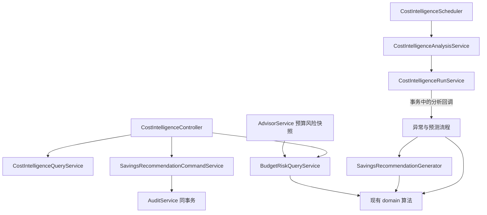

# 成本分析模块职责整理设计

日期：2026-10-10。状态：已完成源码分析和设计，尚未实施业务代码修改。

## 1. 结论与本轮范围

保留 `backend/gateway/frontend` 工程划分，保留 Backend 按业务模块组织及 `api/application/domain/infrastructure` 分层。成本分析模块的问题集中在 application 服务职责，而不是顶层目录。

本轮建议完成 **intelligence 后端整理，以及 Advisor 的预算风险调用适配**。这是一个主模块和一个必要的相邻调用点，不是同时重构两个完整模块。前端维持现有实现，用相关测试核对接口兼容性。

不同时整理网关请求执行、财务对账、预算命令服务。这些场景涉及各自的锁顺序、资金事务和终结状态，需要独立分析和验收。

成本分析持久化已经使用 MyBatis：`CostFactsMapper`、`IntelligenceMapper` 是带 `@Mapper` 的接口，SQL 目前主要通过注解声明。测试夹具中的 JdbcTemplate 不代表生产模块使用 JDBC DAO。本轮不迁移 MyBatis-Plus，也不批量迁移注解 SQL 到 XML。

## 2. 实际阅读的源码与契约

以下路径均相对仓库根目录 `E:\project\AI-CostOps`。

| 文件 | 发现与处理 |
| --- | --- |
| `backend/src/main/java/com/aicostops/intelligence/application/CostIntelligenceService.java` | 约 678 行，混合分析执行、时间序列、节约建议生成、查询、预算风险、建议状态操作及返回类型；拆分的主体 |
| `.../intelligence/application/CostIntelligenceRunService.java` | 已负责分析原子提交与回滚后的失败记录；保留实现，只迁移其依赖的 RunOutcome 类型 |
| `.../intelligence/application/CostIntelligenceScheduler.java` | 只触发到期分析；改注入分析服务，保持调度配置与频率 |
| `.../intelligence/api/CostIntelligenceController.java` | 8 个接口，现均依赖总服务及其嵌套响应类型；改接查询、风险查询、建议命令服务 |
| `.../intelligence/domain/` | 异常、预测、节约及预算风险算法已独立；继续复用 |
| `.../intelligence/infrastructure/CostFactsMapper.java` | 从已入账账本及来源链路读取事实；保持 SQL、组织隔离及 Advisor 排除规则 |
| `.../intelligence/infrastructure/IntelligenceMapper.java` | 分析任务及派生结果持久化，包含状态条件更新；本轮保持职责与 SQL |
| `.../advisor/application/AdvisorService.java` | 仅预算风险快照分支调用 assessScopeBudget；改成依赖较小的预算风险查询服务 |
| `docs/03-acceptance/m18-backend-contract-freeze.md` | V3 权限、接口和财务边界依据 |
| `docs/03-acceptance/m18-openapi.yaml` | V3 接口描述；结合实际 Controller、响应 records 和前端类型核对 |
| `frontend/src/features/intelligence/api/intelligenceTypes.ts` | 前端消费的响应形状，必须保持兼容 |

此前结构审查位于 [目录结构审查](2026-10-10-directory-structure-review.md)。本设计针对其中第 5 项；不表示其余事项已完成。

## 3. 目标文件与职责

下列是建议名称，实施者可以调整名称，但必须保留职责边界。不要把每个方法都变成一个类，也不以硬性行数作为验收指标。

```text
intelligence/
├── api/
│   └── CostIntelligenceController.java
├── application/
│   ├── CostIntelligenceAnalysisService.java       # 分析入口、到期批次、异常与预测组织
│   ├── CostIntelligenceRunService.java            # 原有任务事务与失败持久化
│   ├── CostIntelligenceScheduler.java             # 原有定时触发
│   ├── SavingsRecommendationGenerator.java        # 同使用量向量的建议生成及写入
│   ├── CostIntelligenceQueryService.java          # summary/anomalies/forecasts/recommendations
│   ├── BudgetRiskQueryService.java                # HTTP 风险查询、Advisor 风险证据
│   ├── SavingsRecommendationCommandService.java   # acknowledge/dismiss/markApplied
│   ├── CostIntelligenceReadModels.java            # 5 种查询/命令返回 record
│   ├── AnalysisRunOutcome.java                    # 任务结果，不归属某个服务
│   └── BudgetRiskEvidence.java                    # 跨模块消费的确定性风险证据
├── domain/                                      # 保留现有 4 个算法类
└── infrastructure/                              # 保留现有 2 个 MyBatis Mapper
```

共享校验、分析版本常量及 recommendation 映射只有在确实被多个服务使用时才抽取。可增加一个小型 application 参数类和一个响应装配类；不建立通用 BaseService、BaseMapper、泛型命令框架或新的 Maven 子模块。

`CostIntelligenceReadModels` 不放入 shared：它们只属于成本分析。选择 application 返回模型，是为了避免应用服务反向依赖 Controller 所在的 api 包。`AnalysisRunOutcome` 与 `BudgetRiskEvidence` 独立于具体服务，消除 RunService 对原总服务嵌套类型的源码依赖，也给 Advisor 一个明确的返回契约。

### 3.1 原方法如何迁移

| 原方法/方法组 | 新归属 | 说明 |
| --- | --- | --- |
| 两个 runAnalysis、runDueAnalyses | AnalysisService | 内部可信组织入口和用户鉴权入口分开保留 |
| analyze、childContributions、latestDelta、persistAnomalies、persistForecast、各 grain 构建、completeSeries、remainingDays、driversJson | AnalysisService | 时间序列与异常/预测流程留在同一阅读路径；继续调用 domain 算法 |
| buildSavings、compareCandidates、usageMap、rateMap、fingerprint、ReplayedCandidate | SavingsRecommendationGenerator | 在 RunService 的分析回调内调用，不独立提交 |
| summary、anomalies、forecasts、recommendations | QueryService | 保留组织级 COST_READ 与“昨日版本 1”查询语义 |
| budgetRisk、latestForecastAmount、assessScopeBudget | BudgetRiskQueryService | 共用风险计算及作用域预测查找，区分用户入口和可信内部入口 |
| acknowledge、dismiss、markApplied、validateAppliedLinkage、transition、recommendation | CommandService | public 命令保持事务，审计与状态更新共同提交 |
| recommendationResponse | 共用装配方法/小型 assembler | 查询和命令使用同一映射，避免字段或金额格式分叉 |
| RUN_VERSION、validatedCurrency、validatedDate | 按实际复用抽取 | 不增加一套新规则；版本仍为 1，日期使用注入的 Clock |

Controller 保留一个文件即可，注入三类应用服务；没有必要为 8 个路由增加多个 Controller。Scheduler 只注入 AnalysisService。

AdvisorService 只改构造注入与预算风险分支调用，继续由 Advisor 自己负责授权、主题归属及不可变证据快照。现阶段直接依赖较小的 application 服务足够，不为一个调用点创建多层 port/adapter。

调用关系：



图中的“异常与预测流程”是 AnalysisService 内部方法组，不要求另建类。分析回调与建议生成共同使用 RunService 开启或参与的事务。

## 4. 必须保持的行为

### 4.1 分析任务和时间

- 身份仍是组织、分析日期、币种、run_version；依赖数据库唯一性及 PENDING → RUNNING 条件更新收敛。
- 分析结果与 COMPLETED 共同提交；失败时结果回滚，再记录 FAILED。已有 COMPLETED/FAILED 不因重复调用重新运行。
- RunService 默认参与外层事务；若存在外层事务，等待其回滚完成后，才通过 REQUIRES_NEW 写失败记录。失败记录自身出错时仍抛原异常，保留 suppressed 异常及日志。
- 不给 AnalysisService 或 Generator 新增 REQUIRES_NEW，不用本地锁替代数据库收敛，不在分析事务内吞掉异常后提交部分结果。
- Scheduler 仍按昨日、最近活跃组织与其已结算币种枚举；保持当前上限、时间范围和单组织/币种失败不阻断剩余批次的行为。不重复注册定时任务。
- 历史窗口仍为 `[analysisDate - 29 天, analysisDate)`，observedThrough 为 analysisDate 前一天。completeSeries 按整个窗口逐日补零；月份剩余天数保持现算法。即使觉得日期语义可以改善，也必须另开功能变更。
- 查询仍找昨日与版本 1，不擅自改成“最近一次成功任务”。无任务 summary 为 `STALE`，列表为空。

### 4.2 财务事实和算法

- 派生结果不是新的财务真相。保留 POSTED Ledger、修正反冲/替换、对账调整和直接账单来源的聚合口径；保留 Advisor 自消费排除及币种隔离。
- 无可映射网关链路的直接费用/调整可进入组织等财务粒度，但不得凭空推断 provider/model。
- 异常持久化只用 ORGANIZATION、PROJECT、PROVIDER、LOGICAL_MODEL；TEAM/COST_CENTER 用于预测，不扩展数据库约束。
- 预测粒度和 key、算法阈值、置信度及无效序列的跳过规则保持原样。
- 节约建议选用当前历史成本最高的可评估来源候选，将同一来源使用量向量回放到其他候选价格。候选自身没有历史用量仍可被推荐。
- 缺失某维度费率与显式零费率不同；保持 readiness 筛选、逻辑模型约束、物质性阈值及节约比例至少 5%。
- 数量、费率、金额使用 BigDecimal，保留 scale/舍入逻辑，数量不得转 long 或 double。
- 指纹输入及 SHA-256 算法保持原样，特别是使用量 map 的确定性顺序和金额字符串；本轮不“升级”证据格式。
- 未接入 ACTIVE 路由的生产就绪候选仍可推荐，routingChangeRequired 语义保持。

### 4.3 预算风险与 Advisor

- 即时敞口 = actual + committed + active reservations。
- 期末预测 = actual + committed + forecast future usage。预占不能再加入期末预测，不能被外推。
- PROJECT/TEAM/COST_CENTER 使用自己的 scopeKey；缺少该作用域预测返回零，绝不回退组织预测。
- 风险阈值及 BigDecimal 非负检查仍由现有 domain BudgetRiskService 负责。
- HTTP 风险入口保留组织级 BUDGET_READ；内部 evidence 方法不被新增成公共 HTTP 路由，不能绕过 Advisor 原有主题授权。
- Advisor summary JSON 的 scope/actual/committed/reservations/forecastFuture/immediate/projected/total/risk 字段、金额格式与证据冻结方式保持。

### 4.4 建议命令与接口

- 普通查询组织级 COST_READ；建议命令组织级 BUDGET_MANAGE。先鉴权，再进入组织内查找及修改。
- OPEN → ACKNOWLEDGED；OPEN 或 ACKNOWLEDGED → DISMISSED；ACKNOWLEDGED → APPLIED。条件更新未命中仍报原冲突。
- APPLIED 要求本组织 ACTIVE policy、匹配 logical model、包含推荐 account/model 的 ACTIVE candidate；仅记录人工已完成动作，不修改真实路由。
- 状态写入、审计 append 及返回结果读取保持同一命令事务。将 @Transactional 放在经 Spring Bean 代理调用的 public 入口，不能放在 private 方法上期待其生效。
- 所有现有 URL、请求参数、默认值、权限、状态码及 ProblemCode 保持。现有差异，例如 acknowledge 的条件更新与 dismiss 的先查找，不在重构时统一改写。
- 金额保持十进制字符串；当前 long/Long 类型 ID 保持 JSON 数字及原 null 语义，不顺带切换为字符串 ID。
- summary 字段是 openRecommendations；driversJson 是字符串，不顺手转换为 JSON 数组；robustZScore 是 double。

## 5. 迁移和验证顺序

1. 记录工作区已有修改，读真实调用方与测试，先获得相关测试基线。当前已有大量修改和未跟踪文件，包括 RunService 及其测试，不能 reset/clean 或当作无关文件删除。
2. 迁移返回类型、共用校验/映射；更新 RunService 的类型引用，保持其事务实现。临时旧入口可用于编译过渡。
3. 拆 QueryService、BudgetRiskQueryService 与 CommandService，接好 Controller 和 Advisor；迁移既有测试依赖。
4. 拆 AnalysisService 和 Generator，接好 Scheduler。核对 Generator 没有新的提交边界。
5. 完成后删除原总服务及临时兼容入口，消除旧类型引用。若确有需要保留 facade，必须记录实际调用依据，不能为了不改测试而保留双入口。
6. 跑相关测试，再做一次后端完整 verify。契约不变时不修改前端产品代码，运行 intelligence/advisor 相关前端测试核对消费契约。
7. 新增完成记录，列出职责映射、事务说明、实际命令/结果及未完成项；到此停止，不自行扩展下一模块。

重点复用以下测试，不重写为只检查类存在的测试：

| 测试 | 已覆盖或需重点核对 |
| --- | --- |
| CostIntelligenceRunIntegrationTest | 成功结果提交与重放、失败结果回滚与失败状态持久化、外层事务回滚后记录失败 |
| LedgerCostFactsIntegrationTest | 结算、调整、反冲替换、直接费用及来源归属 |
| SavingsReadinessAndPrecisionIntegrationTest | 无路由候选、无历史用量、缺失/零费率、金额精度 |
| RecommendationAppliedLinkageIntegrationTest | 正确/错误路由关联、只读用户拒绝修改 |
| ScopedBudgetRiskIntegrationTest | TEAM/COST_CENTER 风险隔离，不使用组织预测替代缺失作用域 |
| CostIntelligenceEnginesTest、M18IntelligenceRepairTest | 异常/预测、同模型回放、小数数量、风险算法 |
| AdvisorEvidenceSnapshotIntegrationTest | 不可变快照、证据指纹、拒绝客户端金额与外组织主题 |
| AdvisorScopeBudgetExecutionIntegrationTest | Advisor 作用域预算及跨组织拒绝；不等同于预算风险快照专项测试 |

实施时核对并补齐真正缺少的保护：审计抛异常时建议状态不提交；不同组织访问/修改同 ID；重复与非法状态转移；拆分后的完整分析失败不能留下部分结果；Advisor 的 BUDGET_RISK 快照确实经新入口保留 reservations/forecast/risk。已有等价覆盖就复用，不机械增加重复测试。

说明：本轮是静态分析与方案交付，未运行业务测试，也未执行浏览器验收；表中的测试覆盖来自阅读既有源码，不是本轮通过记录。

## 6. 后续批次

先由其他 AI 实施本方案，再审查 diff 与测试证据。通过后再单独设计 Advisor 内部的证据构建职责整理；它与成本分析的关联已经较清晰，可以复用这轮测试。网关执行与财务对账留在有专项事务/并发验证的一轮处理。

可直接交给实施 AI 的完整任务见 [执行提示词](../../guides/prompts/2026-10-10-cost-intelligence-refactor-prompt.md)。
