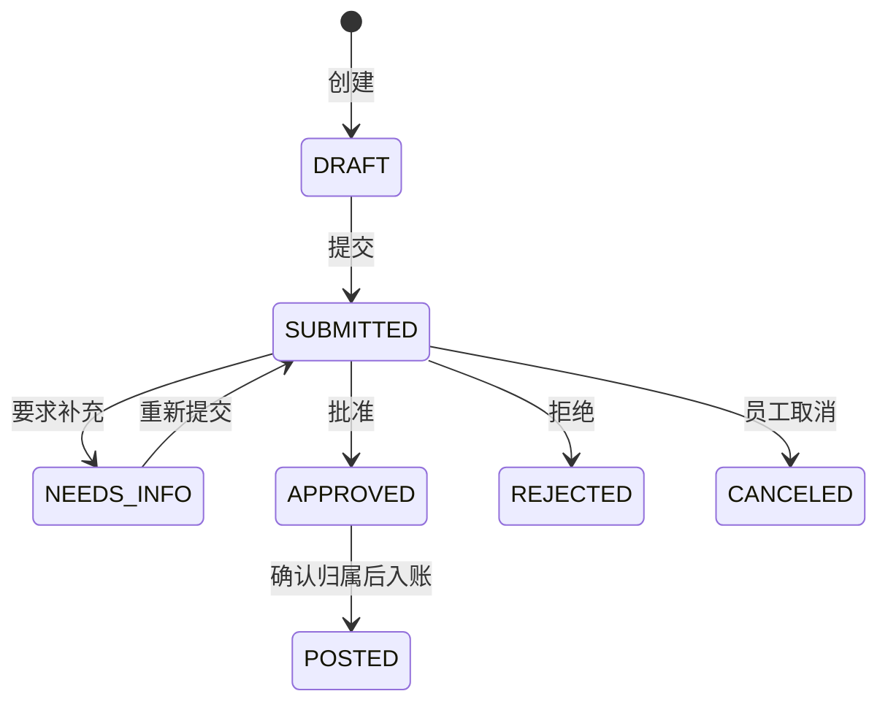

# 报销模块：从 Tlias 到 AI-CostOps 的源码阅读与设计解读

这份文档面向正在学 Tlias、还不熟悉 AI-CostOps 的读者。先读一条业务，再理解它为什么需要权限、版本、幂等和账本。源码按 2026-10-10 本轮整理后的结构说明。

## 1. 先说清楚这个功能做什么

员工创建报销草稿，填写日期、金额和币种，上传凭证后提交。财务可以要求补充、批准或拒绝。批准后的报销还要确认费用归属，再入账；已入账数据通过追加修正保留历史。

这里的“报销”主要实现费用申请、审批和入账，不代表已经给员工转账。`APPROVED` 表示审批通过，`POSTED` 表示进入账本，二者不是同一个动作。

先认识五个字段：

| 字段 | 含义与用途 |
| --- | --- |
| `orgId` / `organizationId` | 当前组织；SQL 必须把它带入查询与更新条件 |
| `claimantMemberId` | 申请人在该组织的成员 ID；不同于登录用户的 `userId` |
| `version` / `expectedVersion` | 数据当前版本 / 页面提交时看到的版本；不一致说明页面已过时 |
| `approvalCaseId` | 这次报销的审批流程 ID；要求补充后重新提交仍复用此流程 |
| `currentAllocationDecisionId` | 当前费用归属决定；需要确认后才能入账 |

## 2. 与 Tlias 相同和不同的地方

对照基线是第 14 阶段“02. 完整的Tlias的代码”，不是所有阶段目录混在一起。

| 同一问题 | Tlias 员工管理 | AI-CostOps 报销 |
| --- | --- | --- |
| 一次请求经过哪些层 | `EmpController → EmpServiceImpl → EmpMapper` | `ExpenseController → ExpenseClaimCommandService → ExpenseClaimMapper` |
| 目录怎么组织 | 顶层 `controller/service/mapper/pojo`，先按技术层找类 | 先找 `expense` 业务，再看 `api/application/domain/infrastructure` |
| 一次保存关联多表 | 员工保存后，用回填 ID 保存工作经历 | 提交报销时创建审批流程、更新报销、追加审批动作，并保存审计和幂等响应 |
| 事务要保证什么 | 员工和经历共同成功或回滚 | 当前业务动作的状态、历史、审计、幂等响应共同成功或回滚 |
| 请求与响应 | 部分接口直接使用 `Emp`；列表有 `EmpQueryParam` | Request 负责 HTTP 形状，Command 表达业务输入，Response 明确可返回的字段 |
| 分页 | PageHelper，通常从第 1 页开始 | 显式 `LIMIT/OFFSET`，从第 0 页开始；分页大小上限 200 |
| 编辑与并发 | 员工更新并全量替换经历，未系统使用版本冲突控制 | 行锁后重查状态及版本，更新 SQL 再检查版本、状态与影响行数 |
| 网络重复请求 | 普通保存方法本身不保证重复安全 | 创建、提交、取消、审核使用幂等键；编辑用版本；入账用业务唯一键 |
| 操作历史 | 通用 AOP 操作日志、员工独立事务日志 | 审批动作是业务事实，审计是结构化记录；已入账后保留追加历史 |
| 数据访问范围 | 本节员工 CRUD 没有组织隔离与本人报销范围 | 服务校验组织权限，SQL 限定组织，本人操作还检查申请人 |

可以迁移的是“Controller 处理输入，Service 编排业务，Mapper 执行 SQL”“共同成功的数据放在一笔事务里”。AI-CostOps 多出的控制对应审批、多人并发和财务记录的需要，不能仅靠把课程类名换掉实现。

参考已核对的 Tlias [业务设计解读](<E:/project/Java_Backend/JavaWeb+Spring Boot+Tlias/后端学习与开发文档/02-项目解读/02-业务实现与设计理由.md>)、[课程改进清单](<E:/project/Java_Backend/JavaWeb+Spring Boot+Tlias/后端学习与开发文档/02-项目解读/04-课程代码改进清单.md>)和[源码资料索引](<E:/project/Java_Backend/JavaWeb+Spring Boot+Tlias/后端学习与开发文档/00-资料索引与版本边界.md>)。这次直接核对了基线的 `EmpServiceImpl` 和 `EmpMapper`；没有运行 Tlias。

## 3. 目录里的类分别负责什么

| 入口 | 阅读目标 |
| --- | --- |
| [前端 expenseApi](../../frontend/src/features/expenses/api/expenseApi.ts) | HTTP 路径、请求体、幂等头、响应类型 |
| [ExpenseController](../../backend/src/main/java/com/aicostops/expense/api/ExpenseController.java) | 员工创建、列表、详情、编辑、提交和取消的 HTTP 入口 |
| [ExpenseReviewController](../../backend/src/main/java/com/aicostops/expense/api/ExpenseReviewController.java) | 财务审核入口 |
| [ExpenseRequests](../../backend/src/main/java/com/aicostops/expense/api/ExpenseRequests.java) | 日期、金额字符串、币种、版本字段解析 |
| [ExpenseCommands](../../backend/src/main/java/com/aicostops/expense/application/ExpenseCommands.java) | 从 HTTP 解析得到的业务输入 |
| [ExpenseClaimCommandService](../../backend/src/main/java/com/aicostops/expense/application/ExpenseClaimCommandService.java) | 员工写入用例：创建、编辑、提交、取消 |
| [ExpenseReviewCommandService](../../backend/src/main/java/com/aicostops/expense/application/ExpenseReviewCommandService.java) | 财务写入用例：要求补充、批准、拒绝 |
| [ExpenseQueryService](../../backend/src/main/java/com/aicostops/expense/application/ExpenseQueryService.java) | 本人列表、本人详情和组织审核详情的权限边界 |
| [ExpenseDetailAssembler](../../backend/src/main/java/com/aicostops/expense/application/ExpenseDetailAssembler.java) | 对已授权的报销组装审批状态、归属确认情况和审批历史 |
| [ExpenseCommandTransactions](../../backend/src/main/java/com/aicostops/expense/application/ExpenseCommandTransactions.java) | 执行完整数据库事务，死锁时最多尝试三次 |
| [ExpenseClaimMapper](../../backend/src/main/java/com/aicostops/expense/infrastructure/ExpenseClaimMapper.java) | 报销主表读写、行锁、版本更新与凭证/归属状态校验 |
| [ExpenseApprovalMapper](../../backend/src/main/java/com/aicostops/expense/infrastructure/ExpenseApprovalMapper.java) | 审批流程读写与追加动作历史 |
| [ExpenseQueryMapper](../../backend/src/main/java/com/aicostops/expense/infrastructure/ExpenseQueryMapper.java) → [查询 XML](../../backend/src/main/resources/mapper/expense/ExpenseQueryMapper.xml) | 本人及审核列表的摘要与总数；共用筛选 SQL |
| [ExpenseClaimStatus](../../backend/src/main/java/com/aicostops/expense/domain/ExpenseClaimStatus.java) | 允许的状态转换与员工可编辑状态 |
| [ExpenseResponses](../../backend/src/main/java/com/aicostops/expense/api/ExpenseResponses.java) | 将应用层结果转换成 HTTP 响应 |

`Assembler` 是结果组装器，不会检查调用者权限；服务必须先完成授权和资源范围检查。它只用于详情及写入响应，列表仍然直接查询摘要。

持久层按实际职责分成三个 Mapper，简单主表更新及 `FOR UPDATE` 留在 Java 注解中，列表的联表和动态筛选放在 `resources/mapper/expense/ExpenseQueryMapper.xml`。XML 的 `namespace` 对应 Java 接口全名，`select id` 对应接口方法；`application.yml` 的 `mybatis.mapper-locations` 负责加载。修改列表筛选时，先看列表与总数共用的 `claimantFilter` / `reviewFilter`，防止两者口径不同。

`Port` 是业务模块需要其他实现提供的能力，例如报销提供给账本的 `ExpensePostingPort`。`Adapter` 是接口的具体实现。已有 Service 直接使用 Mapper 的地方不必为了目录对称再添加一个只转发方法的 Repository。

## 4. 从页面跟踪一次创建

从 [ExpensesNewPage](../../frontend/src/features/expenses/ExpensesNewPage.tsx) 的 `handleSubmit` 开始：

```text
ExpenseForm 收集输入
  → expenseApi.create(body, idempotencyKey)
  → POST /api/v1/expenses
  → ExpenseController.create
  → ExpenseRequests.parseCreate
  → ExpenseClaimCommandService.create
  → ExpenseCommandTransactions.execute
  → ExpenseClaimMapper.insertClaim
  → 保存审计和幂等成功响应
  → ExpenseResponse → 跳转报销详情
```

示例请求体为：

```json
{"expenseDate":"2026-08-01","amount":"100.00000000","currency":"CNY"}
```

金额用字符串传输，后端转成 `BigDecimal`，数据库用 `DECIMAL(20,8)`，输出再转字符串。当前 HTTP 规则要求恰好八位小数，因此 `"100.00"` 不是合法输入。当前金额规则校验精度与表示范围，不包含“必须大于零”的业务限制，不要自行假定。

组织和申请人由登录上下文取得，不由请求体指定。业务服务先校验权限，再生成请求内容哈希。事务里先预占幂等记录，再创建 `DRAFT`，取得插入 ID，并将审计和首次成功响应一起保存。

与 Tlias 的 `useGeneratedKeys` 不同，这里创建报销用 `LAST_INSERT_ID()` 查询刚生成的 ID；相关操作在同一事务连接上执行。目的相同：取得真实主键，再关联后续数据。

## 5. 先上传凭证，再提交审批

[ExpenseEvidenceUploadService](../../backend/src/main/java/com/aicostops/expense/application/ExpenseEvidenceUploadService.java) 先检查是否属于本人且可编辑，然后调用 `EvidenceStorageService` 保存对象。文件存储完成后才进入报销的短事务，锁定报销，重新检查本人、状态和版本，关联 `evidenceId` 并增加版本。

文件上传不在报销事务和死锁重试内部。这一点很重要：数据库回滚不会自动撤销 MinIO 中的文件；如果关联失败，文件可能已保存，不能把这种结果描述成“所有东西都回滚了”。

提交时必须已有凭证，且存储状态为 `AVAILABLE`：

- 首次提交：创建 `approval_case(PENDING)`，将报销改为 `SUBMITTED`，追加 `SUBMIT` 动作。
- 补充后重提：复用原审批流程，将其从 `NEEDS_INFO` 改回 `PENDING`，将报销改回 `SUBMITTED`，追加 `RESUBMIT` 动作。
- 取消：只有 `SUBMITTED` 可以取消；报销变成 `CANCELED`，审批流程也变成 `CANCELED`，追加 `CANCEL` 动作。

这些关联更新都在一笔数据库事务内。审批历史不会像员工经历全量替换那样先删再插，因为需要保留每次动作。

## 6. 审核为什么要同时修改两个状态

`expense_claim.status` 表达报销所处阶段，`approval_case.status` 表达审批流程所处阶段。审核服务必须维护它们的一致关系，并追加动作。



| 审核动作 | 报销变化 | 审批流程变化 |
| --- | --- | --- |
| `REQUEST_INFO` | `SUBMITTED → NEEDS_INFO` | `PENDING → NEEDS_INFO` |
| `APPROVE` | `SUBMITTED → APPROVED` | `PENDING → APPROVED` |
| `REJECT` | `SUBMITTED → REJECTED` | `PENDING → REJECTED` |

本轮把这些对应关系集中到审核服务内部的 `ReviewAction`，调用处直接选择动作，减少容易传错的一长串参数。

批准还需要检查报销日期所属账期允许财务写入。服务先读取日期，在事务中先通过 `ExpenseCloseAdmissionPort` 锁定开放账期，再锁报销，并重新核对日期没有变化。这个顺序参与与关账流程共享的锁协议，重构时不能随意把“锁报销”移到最前。

## 7. 版本、行锁和幂等分别解决什么

**版本**：页面看到版本 2，其他请求把记录改成版本 3；此页面再提交 `expectedVersion=2`，应返回 `409 / STATE_CONFLICT`，让用户刷新。行锁避免同时写入互相穿插，版本则说明“你这次操作基于旧数据”。更新 SQL 还用版本和状态作条件，并检查影响行数是否为 1。

**幂等**：请求已经成功，但成功响应丢失；客户端带原来的键和原来的内容再发一次，服务返回首次保存的成功响应，不再写业务数据。相同键但内容不同应冲突。重放发生在重新检查当前业务状态前，否则首次提交已把状态改变，第二次请求会错误地被拒绝。

幂等记录、报销状态、审批动作和审计共同提交，失败时共同回滚。`ExpenseResponseCodec` 保存的是首次响应快照，所以后来报销已经批准，重放原提交请求仍可能返回首次提交时的 `SUBMITTED`，这是约定行为。

**死锁重试**：数据库选中当前事务作为死锁牺牲者时，先回滚该次事务，再重新执行整次数据库操作。`ExpenseCommandTransactions` 保留原来的 REQUIRED 传播方式，最多三次尝试，仅重试既有死锁异常类型；业务冲突、权限错误不会被自动重试。若外面已有事务，会加入外层事务，不能把它当作总能创建独立事务的工具。

前端创建、提交、取消、要求补充、批准和拒绝共用 [useIdempotentCommand](../../frontend/src/lib/useIdempotentCommand.ts)，对账表单也使用该钩子。同一钩子内，同一动作和请求内容在失败后重试时复用原键；同时点击两次共用正在执行的请求；成功或修改请求内容后才创建下一次动作。它不把费用内容或幂等键持久化到浏览器存储，页面关闭或刷新后不能据此恢复未确认的创建请求。结果不确定时先在当前页重试，若已经离开页面，先查看本人列表确认是否创建成功。

## 8. 批准、确认归属、入账是三个步骤

`postingReady` 来自后端：报销为 `APPROVED`，且当前归属决定为 `CONFIRMED`。前端不能仅看“已批准”就决定可以入账。

阅读 [账本 ExpensePostingService](../../backend/src/main/java/com/aicostops/ledger/application/ExpensePostingService.java) 的 `post`：它组织账期、预算、承诺、费用归属、账本记录等共同成功。报销模块通过 [ExpensePostingAdapter](../../backend/src/main/java/com/aicostops/expense/infrastructure/ExpensePostingAdapter.java) 实现 `ExpensePostingPort`，提供报销数据，锁定并校验已批准状态及归属指针，最后把报销改成 `POSTED`。

这样两个名字对应两种职责：账本 Service 编排入账，报销 Adapter 维护报销自己的状态。适配器的方法依赖账本调用方的事务，不应单独调用后就认为入账完成。

入账使用 `EXPENSE:<expenseId>` 作为业务唯一键，重复入账收敛到已有结果。不要删除已入账记录来“撤回”，应读账本修正流程，保留原始费用与修正证据。

## 9. 表结构怎样对应业务

| 表 | 保存什么 | 阅读时核对什么 |
| --- | --- | --- |
| `expense_claim` | 日期、金额、申请人、状态、版本与当前关联指针 | 更新是否带组织、预期状态、预期版本 |
| `approval_case` | 每次报销的审批流程 | 报销与审批流程是否属于同组织、是否唯一关联 |
| `approval_action` | 追加的提交、补充、批准等动作 | 操作人、前后状态、时间、意见是否留存 |
| `evidence` | 凭证元数据与存储状态 | 提交前必须 AVAILABLE，下载需要授权 |
| `allocation_decision` / `allocation_line` | 费用归属决定及明细 | 当前决定是否 CONFIRMED、是否属于本费用 |
| `api_idempotency` | 请求哈希与首次响应 | 唯一作用域、内容冲突、与业务共同提交 |
| `ledger_posting` / `ledger_entry` | 入账记录与分录 | 业务唯一键、金额、归属与追加修正 |

报销和审批主结构见 [V10 迁移](../../backend/src/main/resources/db/migration/V10__m4_expense_approval.sql)，`POSTED` 状态见 [V14 迁移](../../backend/src/main/resources/db/migration/V14__m5_expense_posted_state.sql)。数据库约束配合服务规则，不能因为服务先查过就省掉最终约束。已发布迁移不直接重写。

## 10. 用测试读懂失败后的结果

按以下顺序读已有测试，比一次读完所有类更容易理解：

1. [ExpenseLifecycleIntegrationTest](../../backend/src/test/java/com/aicostops/expense/ExpenseLifecycleIntegrationTest.java)：创建、上传、提交、补充、编辑、重提、批准。预测每一步的状态与版本。
2. [ExpenseOwnLifecycleIntegrationTest](../../backend/src/test/java/com/aicostops/expense/ExpenseOwnLifecycleIntegrationTest.java)：本人范围和失败动作。
3. [ExpenseIdempotencyIntegrationTest](../../backend/src/test/java/com/aicostops/expense/ExpenseIdempotencyIntegrationTest.java)：重复请求与内容冲突。
4. [ExpenseReviewConcurrencyIntegrationTest](../../backend/src/test/java/com/aicostops/expense/ExpenseReviewConcurrencyIntegrationTest.java)：并发审核不会各自成功改变状态。
5. [ExpenseSummaryQueryIntegrationTest](../../backend/src/test/java/com/aicostops/expense/ExpenseSummaryQueryIntegrationTest.java)：列表摘要、组织范围、关联状态和分页错误。
6. [ExpenseCommandTransactionsIntegrationTest](../../backend/src/test/java/com/aicostops/expense/ExpenseCommandTransactionsIntegrationTest.java)：真实事务回滚后重试，重试耗尽无部分写入，普通异常不重试。异常是注入的，不代表模拟了真实双连接死锁竞争。
7. [ExpensePostingIntegrationTest](../../backend/src/test/java/com/aicostops/ledger/ExpensePostingIntegrationTest.java)：批准后入账、重复入账与账本结果。
8. [E2eExpenseMainlineIntegrationTest](../../backend/src/test/java/com/aicostops/e2e/E2eExpenseMainlineIntegrationTest.java)：通过认证 HTTP 测试入口贯通提交、审批、归属、入账、对账及关账。这是后端 MockMvc 验证，包含测试夹具，不是浏览器实际用户操作。

读完后，尝试自己回答：没有凭证能不能提交？别人能不能改我的报销？审批通过是否等于入账？旧版本为什么返回 409？请求失败后哪些表改变、哪些不能改变？上传文件能不能靠数据库回滚撤销？

## 11. 下一次新增功能，怎样沿用这套组织方式

先写“谁在什么状态下做什么、输入输出是什么、失败后留下什么”，再定义 Request/Command/Response。一个用例放一个清楚的服务方法，事务范围和锁顺序写在该用例附近；SQL 留在 Mapper，业务状态留在 domain。

共同的详情组装交给 `ExpenseDetailAssembler`，不要复制到新服务；报销数据库写入复用 `ExpenseCommandTransactions`，外部上传仍留在事务外。列表查摘要，详情查历史。跨模块通过已有 Port 明确能力和归属，不让报销服务直接写账本表。

最后选择正常、权限、版本冲突、重复请求、回滚场景做验证，并更新这份阅读路径。只有在一个类确实承担了多个独立业务职责时再拆分；类数量更多不等于更容易读懂。

## 12. 前端输入、失败提示与后端的对应关系

金额不要先变成 JavaScript `number`：例如 `999999999999.99999999` 转成浮点数后可能变成 `1000000000000`。报销 [ExpenseForm](../../frontend/src/features/expenses/components/ExpenseForm.tsx) 使用 `InputNumber` 的 `stringMode`，通过已有的 `parseUserDecimal8 → formatDecimal8` 精确补足8位小数。整数最多12位，小数最多8位，超界或多余小数直接报错，不偷偷四舍五入。后端仍用 `ExpenseMoneyPolicy` 和 HTTP 解析做最终验证；负数费用按已有协议表示冲回，不是实际付款。

页面的失败提示也属于功能：详情查询失败时明确显示加载失败和重试；财务分摊读取失败时不能当作“尚无分摊”再创建草稿，也不能带猜测的承诺关联入账。发生版本冲突可点击“刷新详情”，按新版本重建编辑表单，避免旧金额搭配新版本覆盖别人的修改。员工及财务的状态文字集中在 [presentation](../../frontend/src/features/expenses/presentation.ts)，使用完整状态类型约束，新增状态时编译器会提示漏项。

凭证上传有两次检查：存储前拒绝已经过期的页面版本；存储后进入事务，再用锁、版本和状态阻止上传期间发生的并发修改。前者减少无效上传，后者保证最终关联正确。它仍然不是数据库与MinIO之间的分布式事务。

## 13. 自检题的答案

| 问题 | 答案与关键源码 |
| --- | --- |
| 没有凭证能提交吗？ | 不能。前端禁用按钮，服务还检查 evidenceId 和 AVAILABLE；仅禁用按钮不能代替服务校验。 |
| 改URL能看另一个员工的凭证吗？ | 本人入口检查 claimantMemberId；不属于本人返回404。财务走审核入口并检查当前组织和EXPENSE_REVIEW。 |
| 批准就是入账吗？ | 不是。先APPROVED，再确认归属，最后由账本服务写POSTED。 |
| 旧版本为什么409？ | 请求基于过期的记录，服务拒绝覆盖；重新读取后再决定是否修改。 |
| 后端成功而响应丢失怎么办？ | 当前页面带同一动作、同一内容、同一键重试，后端返回首次响应；不能为了重试换键。 |
| 两人同时记账会增加两次实际额吗？ | 账期、预算及来源锁和业务唯一键使结果收敛到同一发布记录；新增并发测试同时检查记录、版本、审计及预算。 |
| 账期CLOSING或CLOSED怎么办？ | 首次批准及首次入账拒绝。已完成入账的重放仍返回历史结果，不能因后来关账而重写历史。 |
| 成本中心停用怎么办？ | 停用对象不出现在可选目录；草稿创建和确认都检查ACTIVE。确认后的归属是历史事实，入账不重新挑选目标。 |
| 审计写入失败会留下已批准状态吗？ | 不会。状态、审批历史、审计和幂等响应处于同一事务；失败测试通过真实数据库核对回滚。 |
| 文件能靠数据库回滚撤销吗？ | 不能。上传期间发生并发改变时，文件可能已经保存而未关联报销；需要区别存储结果与关联结果。 |

详细验收场景、执行命令与证据见 [报销可靠性收尾记录](../03-acceptance/2026-10-10-expense-reliability.md)。先独立阅读一条创建链，再用表中问题检查理解；不必一次记住所有类名。
